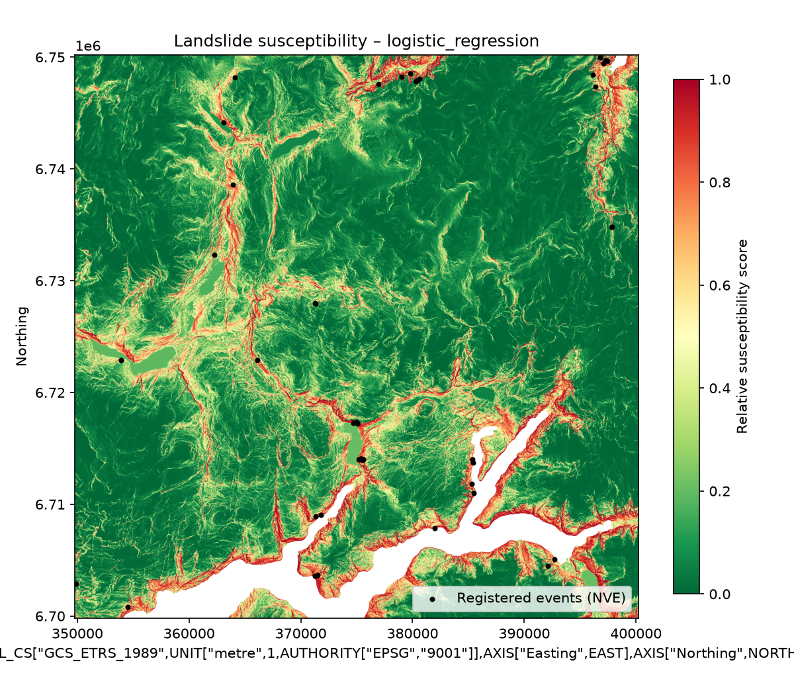
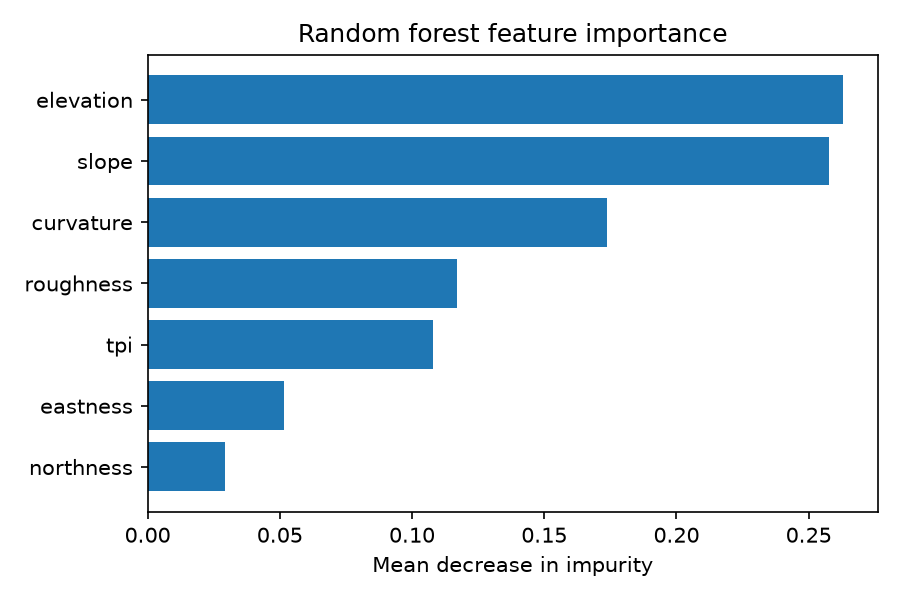

# Landslide Susceptibility – Voss / Granvin, Vestland

DAT158 Machine Learning – final project (HVL, autumn 2026)
Author: Jakob Hatland

A Streamlit web app that estimates **susceptibility to soil slides and debris flows
(jord- og flomskred)** at a user-selected location in the Voss/Granvin area, using a
machine-learning model trained on registered landslide events and terrain derivatives
from a 10 m digital terrain model.

The task is framed as **binary classification** (landslide susceptibility mapping):
cells where landslides have been registered (label 1) versus pseudo-absence cells
(label 0), described by terrain features. The model output is a **relative
susceptibility score** per 10 m cell.

---

## Study area

The study area is the extent of Kartverket DTM10 tile **6703_2** (approx. 50 × 50 km,
ETRS89 / UTM zone 32), which covers Voss, Granvin and Ulvik in inner Hardanger.

The area was limited deliberately:
- typical western-Norwegian fjord-valley topography with frequent soil slides and debris flows,
- enough registered events for training and spatial validation,
- manageable raster size (≈ 25 million cells) for processing on a laptop.

The model is **not** expected to generalise outside this area without retraining.

## Data

Raw data is not committed (size and licence). Download manually:

| Dataset | Source | Licence | Location in repo |
|---|---|---|---|
| Skredhendelser (landslide events) | NVE – ArcGIS REST service (fetched by `fetch_skred.py`) | NLOD 2.0 | `data/raw/skredhendelser_voss.geojson` |
| DTM 10 Terrengmodell, tile 6703_2 (UTM32) | Kartverket – https://hoydedata.no | CC BY 4.0 | `data/raw/dtm10/6703_2_10m_z32.tif` |

Landslide events are fetched for a bounding box (WGS84: 5.9–7.1 °E, 60.35–60.95 °N)
and filtered to soil slides (jordskred) and debris flows (flomskred), 154 events in
total; 49 of these fall within the DTM tile and are used for training. Quick clay
slides and unspecified mass movements are excluded.

## Method

**Terrain features** (computed from the DTM at 10 m):

| Feature | Description |
|---|---|
| `elevation` | Terrain height (m) |
| `slope` | Slope angle (degrees) |
| `northness`, `eastness` | Cosine and sine of aspect (avoids the 0°/360° discontinuity) |
| `curvature` | Laplacian of elevation; positive = concave (flow convergence) |
| `roughness` | Local standard deviation of elevation, 3 × 3 window |
| `tpi` | Topographic position index: elevation minus mean in a 150 m window |

Cells below 1 m elevation (fjord and sea surface) are masked out, so that trivially
flat water cells do not inflate the scores.

**Samples**
- Positives: landslide events, snapped to the DTM grid (one sample per cell).
- Negatives: **pseudo-absence** points sampled randomly from valid cells at least
  200 m from any registered event, ratio 3:1 to positives.

**Models**
- Logistic regression (standardised features)
- Random forest (300 trees, `min_samples_leaf=5`)

Both use balanced class weights.

**Validation – spatial block cross-validation.**
Samples are grouped into 2 × 2 km blocks, and `GroupKFold` ensures that no block
appears in both training and test folds. A random-split CV is also reported for the
random forest to quantify the optimistic bias caused by spatial autocorrelation.

Metrics: ROC-AUC and PR-AUC (average precision). The model with the highest spatial
ROC-AUC is refitted on all data and used in the app.

## Results

| Model | Spatial CV ROC-AUC | Spatial CV PR-AUC | Random CV ROC-AUC |
|---|---|---|---|
| Logistic regression | 0.904 | 0.735 | – |
| Random forest | 0.901 | 0.722 | 0.932 |

Training data: 49 events, 147 pseudo-absence points, 156 spatial blocks of 2 × 2 km,
5-fold spatial cross-validation.

Both models reach a spatial ROC-AUC of about 0.90. Logistic regression performs
marginally best and is used in the app, which suggests that the relationship is
largely monotonic and driven by a few terrain variables. For the random forest, the
random-split CV gives a ROC-AUC of 0.932 against 0.901 with spatial CV. The difference
illustrates the optimistic bias caused by spatial autocorrelation when test points lie
close to training points.

The scores should be read with caution: with only 49 positives the estimates carry
considerable uncertainty, and pseudo-absence points drawn from the whole tile include
many easy negatives (flat valley floors, plateaus), which tends to inflate ROC-AUC.




## Limitations

- **Pseudo-absence:** negative samples are not confirmed non-landslide locations; some
  may be susceptible terrain where no event has been registered yet. The score is
  therefore a relative susceptibility index, not a probability of occurrence, and its
  calibration depends on the class ratio.
- **Small sample:** 49 positives give uncertain performance estimates.
- **Positional accuracy:** older events in the NVE database can have large location
  uncertainty, which adds label noise.
- **Elevation dominates feature importance**, which likely reflects reporting bias
  (events registered along valley roads and settlements) rather than a purely
  physical effect.
- **Terrain only:** no precipitation, soil type (løsmasser), vegetation or land use.
- **Not for decision-making:** this is a course project and not a substitute for NVE's
  official hazard and awareness maps (aktsomhetskart).

## Repository structure

```
.
├── app.py                   Streamlit web app
├── pipeline.py              Features, dataset, training, evaluation, maps
├── fetch_skred.py           Fetch and filter landslide events from NVE ArcGIS REST
├── data/
│   ├── raw/                 Source data (not in git)
│   └── processed/           Filtered events + dataset.csv (not in git)
├── models/                  model.joblib, metrics.json (rasters not in git)
├── report/figures/          Susceptibility map and feature importance
└── requirements.txt
```

## Reproduce

```bash
python -m venv .venv
# Windows: .venv\Scripts\activate    Linux/macOS: source .venv/bin/activate
pip install -r requirements.txt geopandas requests scipy matplotlib

python fetch_skred.py      # download and filter landslide events
python pipeline.py         # features, training, evaluation, maps
streamlit run app.py
```

Run all commands from the repository root. The trained model (`models/model.joblib`),
metrics and figures are committed. The feature raster used by the app
(`models/features.tif`, ≈ 475 MB) exceeds GitHub's file size limit and is not
committed, so `pipeline.py` must be run once before `streamlit run app.py`.

On Windows with PostGIS installed, a conflicting PROJ database may be picked up. Set
the PROJ path before running:

```powershell
$env:PROJ_LIB = python -c "import pyproj; print(pyproj.datadir.get_data_dir())"
$env:PROJ_DATA = $env:PROJ_LIB
```

## Sources and AI use

- NVE – Skredhendelser (national landslide database).
- Kartverket – DTM 10 Terrengmodell, via hoydedata.no.

AI coding assistance (Claude, Anthropic) was used for code scaffolding and review.
All design decisions, data processing and results were verified by the author.